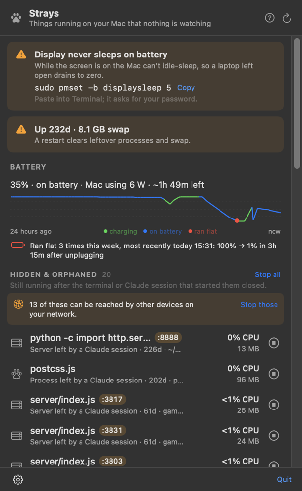

# Strays

A menu bar app that shows the processes you can't see but your battery can: dev servers
whose terminal or Claude session is long gone, headless browsers left running by scripts,
idle Claude Code sessions, things keeping the Mac awake, and forgotten VMs and simulators.

Built after a laptop kept dying: a `ts-node-dev` stuck in a startup loop for 20 days and four
headless Chromes rendering a dashboard nobody was looking at were burning ~7 W between them.



## What it finds

| Section | How it's detected |
|---|---|
| **Battery** | Charge over the last 24 h; **energy used per app since you unplugged** (Chrome 9 Wh, hidden processes 6 Wh, …, measured from the kernel's per-process energy counters); last night's sleep (how many background wake-ups, how much it used); when it last ran flat and how fast; and how much of the current draw is hidden processes. |
| **Hidden & orphaned** | Your processes reparented to launchd whose session's shell has exited, or that Claude Code started (its environment, or what Strays saw launch them). Grouped with their children. Automation browsers: Chrome/Chromium/Edge/Firefox started with `--headless`, `--remote-debugging-port` or `--enable-automation` (your normal Chrome isn't touched); open pages are read from the DevTools endpoint. Servers other devices can reach are called out, with one click to stop them all. **Duplicates** (several copies of the same command in the same folder) are grouped, with "Keep newest, stop the rest". |
| **Claude sessions** | Every running `claude`, its project, idle vs working, tool (MCP) servers, and background tasks older than 30 s. "End N idle" closes sessions idle for over a day. |
| **Keeping the Mac awake** | Power assertions (`caffeinate`, apps), with the Claude session that started them. macOS's own daemons are filtered out. |
| **VMs & simulators** | Docker Desktop (+ each container's CPU and memory; quitting lists the containers it will stop first), OrbStack, Colima/Lima, UTM, Parallels, VirtualBox, Tart, other Virtualization.framework VMs, booted iOS simulators, Android emulators. |

Every row says what it is in plain words, for example "Server left by a Claude session · 61d · games/panel-skirmish".
Click a row for a labelled breakdown: what it is, what started it (including the **launch chain**, e.g.
`node scripts/screenshot.mjs ← Claude Code (personal/home-assistant)`), network exposure, how long it's
been running, CPU time and energy used so far, command and folder. The **?** button explains every term
on screen.

**Stop** sends SIGTERM to the whole group, waits 3 s, then SIGKILLs anything still alive.
Something stuck in a synchronous loop never runs its SIGTERM handler, so the follow-up kill
is what actually stops it. Simulators get `simctl shutdown`, and Docker gets a proper quit.
Right-click a row to ignore it, copy the command, or open its folder.

The menu bar shows a paw print and a count. It switches to a 🔥 and live watts when something
hidden is using power (sustained ≥15% CPU or ≥1 W).

### Notifications

- **Something hidden drains the battery:** stayed hot for 10 minutes on battery. Buttons: *Stop it*, *Ignore it*.
- **A Claude session left things running:** see below. Buttons: *Stop them*, *Keep running*.
- **The Mac ran out of battery:** sent after it comes back, with how fast it drained and, if Strays was
  measuring, the biggest energy users during that discharge.
- **Auto-cleanup** (opt-in, gear menu → *Auto-stop leftovers*): leftovers from *ended* Claude sessions
  that are idle and older than 6 h, 1 day or 3 days. Announced 10 minutes before stopping, with
  *Stop now* and *Keep them* buttons, and shown in the panel. Anything ignored is never touched.

Both can be switched off in the gear menu. macOS asks for permission on first launch. If you missed
the prompt, turn Strays on in System Settings → Notifications. `~/Library/Application Support/Strays/activity.log`
records every notification sent, and every session-end check.

### Claude Code hooks

`./install.sh` offers to add two hooks to `~/.claude/settings.json`; the gear menu can add them later.

**SessionStart** (`strays --session-start`): a new session is told what's already running in its
project, e.g. "vite on :5180, pid 11825, running 4 days, left behind by an earlier Claude session".
It's also told about any duplicates, and that it should reuse a running server instead of starting
another copy on a new port. That pattern is how five panel-skirmish servers ended up running at once.
If nothing is running in the project, it adds nothing.

**SessionEnd** (`strays --session-end`): when a session closes, the hook runs `strays --session-end`. That records the session's
background tasks and anything it started that has already detached, while the session's process is
still alive to attribute them. A few seconds after the session has really exited, the app checks
what survived and notifies you. The record also gives those processes an origin later, even for
binaries whose environment macOS hides, such as Chrome and `/bin/sh`. The merge touches only Strays' own entries,
keeps the file's formatting, and leaves a `.strays-backup`. `./uninstall.sh` removes them again.
The hooks apply to Claude sessions started after they're installed.

## Install

```sh
git clone <this repo> ~/Development/tools/strays
cd ~/Development/tools/strays && ./install.sh
```

It needs Apple's command line tools (`xcode-select --install`). It builds from source, puts
`Strays.app` in `~/Applications`, links the CLI to `~/.local/bin/strays`, and opens at login
(you can switch that off in the panel footer). No sudo. `./uninstall.sh` removes everything.

For a Mac without developer tools, run `./scripts/dist.sh` to build a universal zip. Unzip it into
`~/Applications`, then run `xattr -dr com.apple.quarantine ~/Applications/Strays.app`. The zip is
ad-hoc signed, not notarized.

## CLI

```sh
strays               # the same scan, as text
strays --json        # machine-readable
strays --stop <pid>  # stop the group that pid belongs to (TERM → KILL)
strays --port 3000   # what's listening on :3000, who started it, whether the network can reach it
strays --battery     # when it last ran flat, last night's sleep, energy by app since unplugging
strays --update      # git pull (if there's a remote) and reinstall: how the other Macs stay current
strays --session-end # for the Claude Code hook (reads the hook JSON on stdin)
```

This is useful from inside a Claude session: "run `strays` and stop anything you started that's
still running".

## Cost

Measured with the kernel's per-process energy counter:

| | Panel closed | Panel open |
|---|---|---|
| CPU | ~0.1% | ~2% |
| Power | ~0.00 W | ~0.01 W |
| Memory | ~20–45 MB | ~43 MB |
| Refresh | 15 s on power, 30 s on battery | 3 s |

It scans with direct libproc and sysctl calls, never by spawning `ps` or `lsof`. A scan of
~900 processes takes about 12 ms. While closed, only the menu bar badge updates, and only when it
changes. While open, the panel is one Equatable display model: rows whose text didn't change aren't
redrawn, and a refresh that changes nothing on screen publishes nothing. `docker ps` and the
DevTools lookups run every 10 s, and `pmset` once per opening and then every minute, only while
the panel is open. The power log (`pmset -g log`, about 7 MB) is read at most once an hour, and only while
the panel is open. A battery sample is appended every 5 minutes (about 200 bytes).

## Limits

- macOS hides the environment of platform binaries (`/bin/sh`) and hardened apps (Chrome).
  When one of those was orphaned before Strays saw it, and before the hook existed, its origin shows
  as unknown. Launch records are kept in `~/Library/Application Support/Strays/provenance.json`, so
  they survive app restarts.
- The power log only goes back about a week, so "ran flat" history starts there.
- Energy per app covers your own processes. The display, WindowServer (graphics) and macOS itself
  can't be measured per process; the panel says how much the battery supplied in total, for comparison.
- Watts come from `proc_pid_rusage` v6, which needs macOS 14. On macOS 13 rows show CPU only.
- Only your own processes are inspected; root daemons are out of scope.
